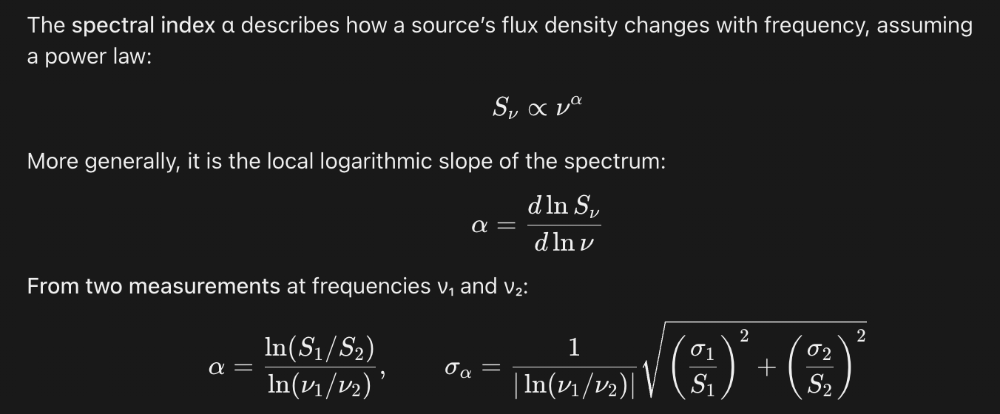

## What it does

This is a general skill to run whenever you start an astrophysical discussion with an LLM, helps tuning the model to be honest and precise. It is small enough to contribute a negligible amount of tokens.

## SKILL.md

[Download the skill](astro-research.zip){.download-button download="astro-research.zip"} and unzip it in your agent's skills directory. Or [download SKILL.md](SKILL.md){download="SKILL.md"} alone.

SKILL.md:

```{.markdown include="SKILL.md"}
```

## How it was tested

Claude Opus 5.5 in Claude Code, 2026-11-01. The prompt `definition of spectral index`, with and without the skill. With the skill loaded the agent was more careful with astronomical data: the answer gave three references and explained how to estimate the uncertainty of the quantity. Without the skill, neither was there.



## History

- 2026-11-04: first version (L1), Francesco De Gasperin.
