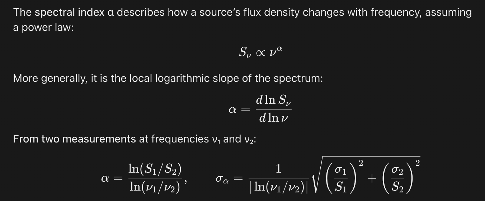

## What it does

The agent is much more careful in dealing with astronomical data, answers are more precise and often with citations.

## SKILL.md

[Download SKILL.md](SKILL.md){download="SKILL.md"} and put it in a folder `astro-research` in your agent's skills directory.

```{.markdown include="SKILL.md"}
```

## How to check the result

**Tested on:** Ask for a definition, for instance "spectral index" and check if references are generated.

A test with the active skill on the prompt
`definition of spectral index`
produced 3 references and explained how to evaluate the error of such quantity. These information was missing in the call without the skill.

Definition when the skill is loaded:


## Known failures

None known yet.

## History

- 2026-11-04: first version (L1), Francesco De Gasperin.
